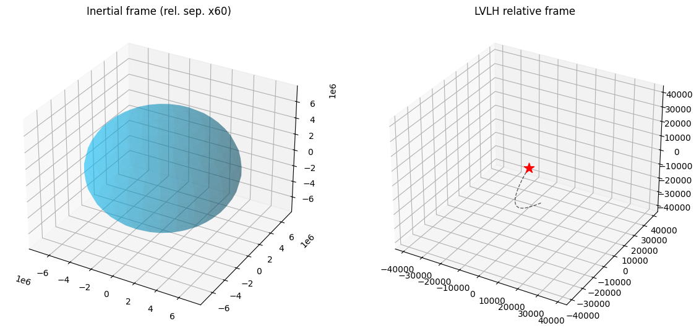
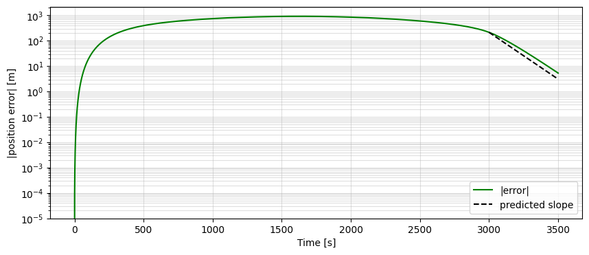
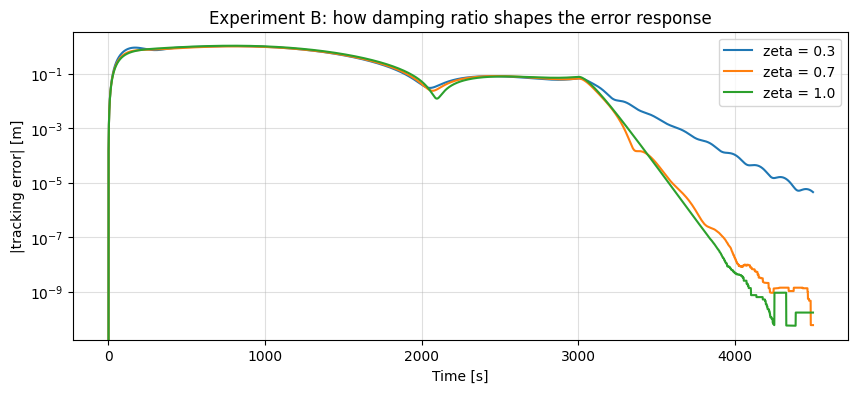

# Spacecraft Rendezvous Control

Full-state feedback control of a chaser spacecraft rendezvousing with a target spacecraft on a different orbit. The project builds the complete pipeline from nonlinear orbital dynamics to a validated closed-loop controller, and studies how pole placement choices shape the transient response.

## Overview

Two spacecraft begin on different circular orbits around Earth (500 km and 520 km altitude, with a small inclination and phase offset , roughly 31 km initial separation). The chaser must track a smooth reference trajectory to the target using thrust acceleration bounded by $|u_i| \le 0.5$ m/s².

The state is the chaser's position and velocity relative to the target, expressed in the target's rotating LVLH (Local Vertical, Local Horizontal) frame:

$$\mathbf{x} = [x,\, y,\, z,\, \dot{x},\, \dot{y},\, \dot{z}]^T$$

where $x$ is radial, $y$ is along-track, and $z$ is cross-track.



## Contents

The notebook (`Project_Cleaned.ipynb`) is organized into four parts:

1. **Linearization.** Analytic Jacobians of the nonlinear relative dynamics about the origin yield the Clohessy–Wiltshire state-space model. Verified against a finite-difference Jacobian (max error < $10^{-12}$).
2. **Open-loop analysis.** Eigenvalues of $A$ and a one-orbit uncontrolled simulation show why feedback is required: the natural modes will not bring the chaser to the target.
3. **Pole placement.** A full-state feedback gain $K$ is computed with `scipy.signal.place_poles` to place six distinct closed-loop poles. The dominant pole is chosen for a settling time well below the 3000 s rendezvous window while keeping commanded thrust within the actuator limit.
4. **Investigations**
   - **Experiment A:** pole speed swept at 0.3×, 1×, 2×, 5×, trading tracking accuracy against $\Delta v$ and exposing the point at which the actuator saturates.
   - **Experiment B:** damping ratio study with complex conjugate poles at $\zeta \in \{0.3, 0.7, 1.0\}$, demonstrating the second-order transient (overshoot, oscillation period) predicted analytically.

A 3D animation of the closed-loop trajectory is rendered at the end, showing both the inertial view (with the relative separation scaled up for visibility) and the LVLH-frame approach to the target.

## Key Equations

**Nonlinear relative dynamics in the target's LVLH frame:**

$$\ddot{x} = 2n\dot{y} + n^2 x - \frac{\mu (r_t + x)}{\rho^3} + \frac{\mu}{r_t^2} + u_x$$

$$\ddot{y} = -2n\dot{x} + n^2 y - \frac{\mu y}{\rho^3} + u_y$$

$$\ddot{z} = -\frac{\mu z}{\rho^3} + u_z$$

**Linearized (Clohessy–Wiltshire) model** $\dot{\mathbf{x}} = A\mathbf{x} + B\mathbf{u}$:

$$
A = \begin{bmatrix}
0 & 0 & 0 & 1 & 0 & 0 \\
0 & 0 & 0 & 0 & 1 & 0 \\
0 & 0 & 0 & 0 & 0 & 1 \\
3n^2 & 0 & 0 & 0 & 2n & 0 \\
0 & 0 & 0 & -2n & 0 & 0 \\
0 & 0 & -n^2 & 0 & 0 & 0
\end{bmatrix}, \quad
B = \begin{bmatrix} 0_{3\times 3} \\ I_3 \end{bmatrix}
$$

**Closed-loop error dynamics** under $\mathbf{u} = K(\mathbf{x}_d - \mathbf{x})$:

$$\dot{\mathbf{e}} = (A - BK)\,\mathbf{e}$$

## Requirements

- Python 3.9+
- `numpy`
- `scipy`
- `matplotlib`
- `jupyter` (I use Google Colab)

Install with:

```bash
pip install numpy scipy matplotlib jupyter
```

## Running

Open the notebook and run all cells top to bottom:

```bash
jupyter notebook Project_Cleaned.ipynb
```

The simulator uses RK4 integration in the ECI frame on the full nonlinear two-body dynamics; the linearized model is used only for controller design, not for propagation. This means closed-loop results reflect true tracking performance against the real (nonlinear) plant.

## Results Summary

- Linearization verified to $\sim 10^{-13}$ against finite differences.
- Open-loop eigenvalues include a repeated pair at the origin and complex pairs at $\pm jn$, confirming marginal stability , no natural convergence to the target.
- Nominal closed-loop design (poles between $-0.0085$ and $-0.0125$ rad/s) tracks the quintic reference and settles to sub-meter final error with peak thrust well under the 0.5 m/s² limit.



- Experiment A shows the expected fuel/accuracy trade-off, with diminishing returns as poles are pushed further left and the fastest case approaching thrust saturation.
- Experiment B reproduces the analytical second-order predictions: the $\zeta = 0.3$ case oscillates with a measured period near the predicted 329 s and overshoot near 37%, while $\zeta = 0.7$ and $\zeta = 1.0$ settle smoothly.




